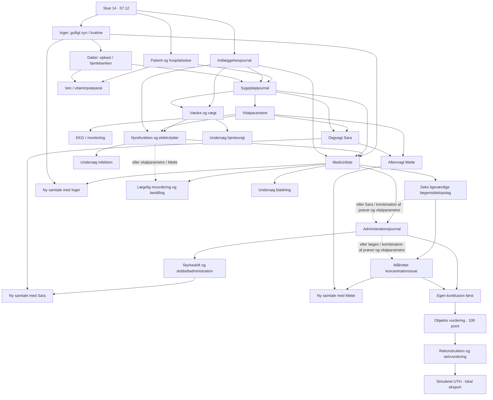

# Sag 001 – narrative afhængigheder

**Indeholder løsningen.** Hver scene vises med billede, sted, oprindeligt tidspunkt, dokumenter/dialog og valgfri refleksion. Nye valg vises fire ad gangen; flere valg kan bladres frem. Undersøgte scener ligger i arkivet. Opslag ligger i et separat lokalt opslagsværk.

Figuren er et overblik. De præcise AND/OR-betingelser ligger i [casedata](../../public/dose-case-001.js). Sagen kan afsluttes før alle spor er fundet; den studerende får en neutral advarsel og kan fortsætte efterforskningen. Pilene til afslutningen er derfor meningsfulde eksempler, ikke obligatoriske låse.

Tre testede hovedveje krydser hinanden:

1. Inger → datter → sygeplejejournal → vitalparametre → medicinliste → farmakologi → administration → dispensering → blodprøver → målrettet svar.
2. Indlæggelse → væske/vægt → nyrefunktion/elektrolytter → medicinliste → farmakologi → administration → dispensering → målrettet svar → sammenhold øvrige kliniske fund.
3. Stuen → sygeplejejournal → vitalparametre → Sara → medicinliste → administration → dispensering → farmakologi → målrettet svar → sammenhold prøver og pårørende.

En fjerde komplet gennemspilning undersøger ven/vitaminer, hjertesvigt, infektion og blødning og vender derefter tilbage til medicindokumentationen. Ingen hypotese er en obligatorisk nøgle til kritiske spor. Kritiske oplysninger kan også findes uden hints og uden at have åbnet alle valgfrie scener.

Hypotesestop foreslås efter 3, 7 og 12 besøgte scener. Tidligere hypoteser revideres ved at gemme en ny version med begrundelse, tilknyttede spor og sikkerhed. Forkerte hypoteser bedømmes ikke undervejs og kan ikke lukke eksisterende veje.
