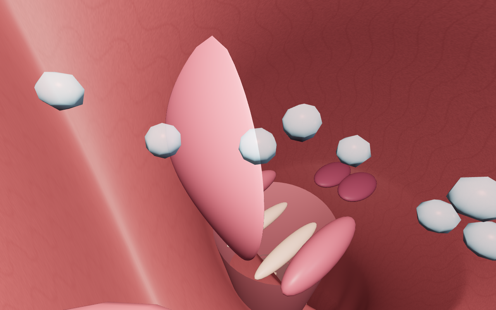
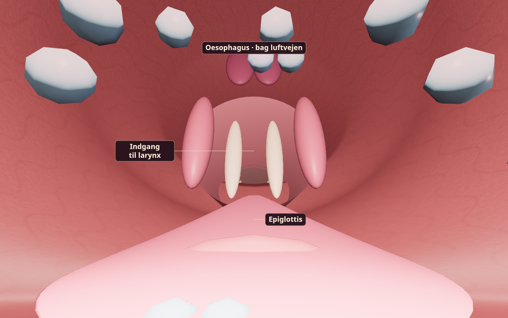
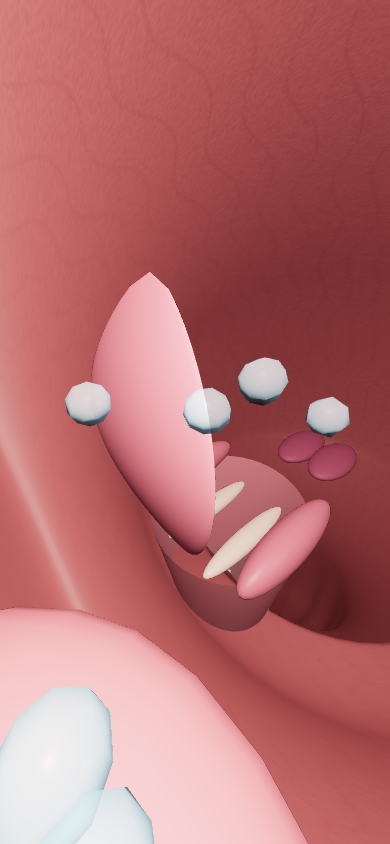
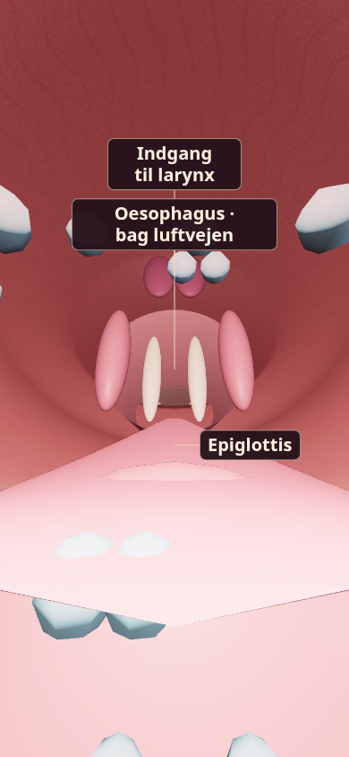
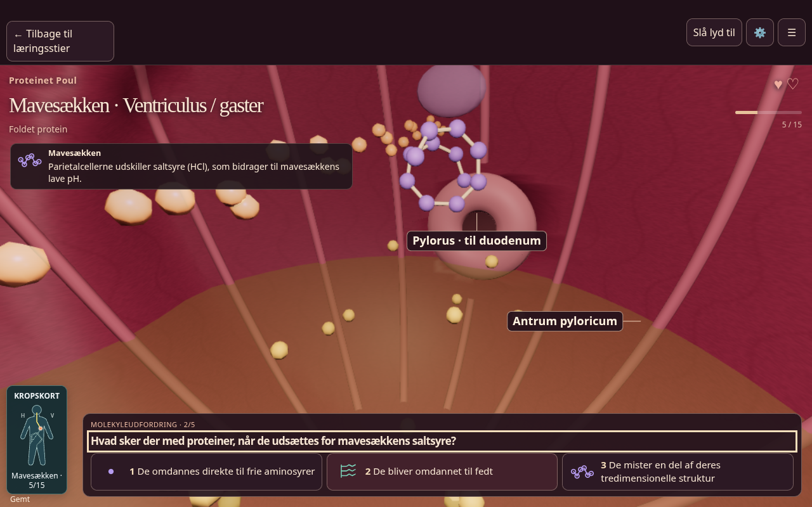
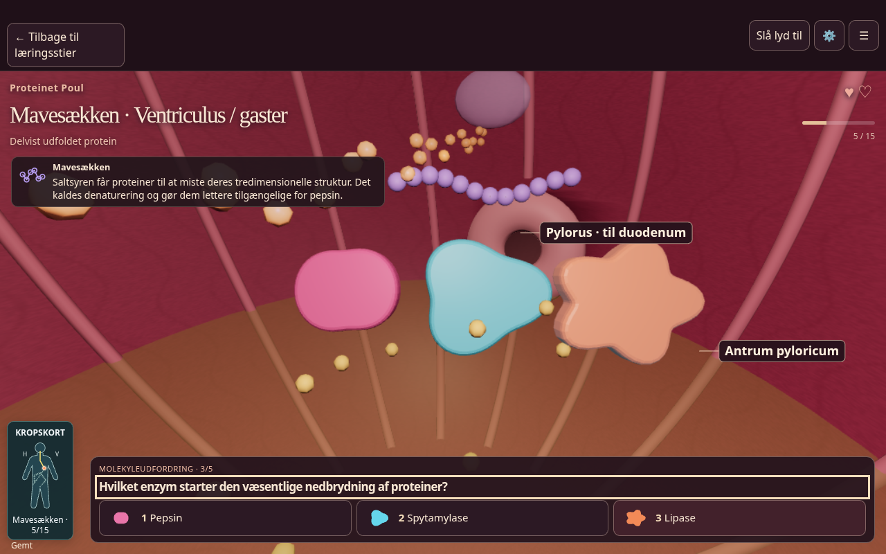
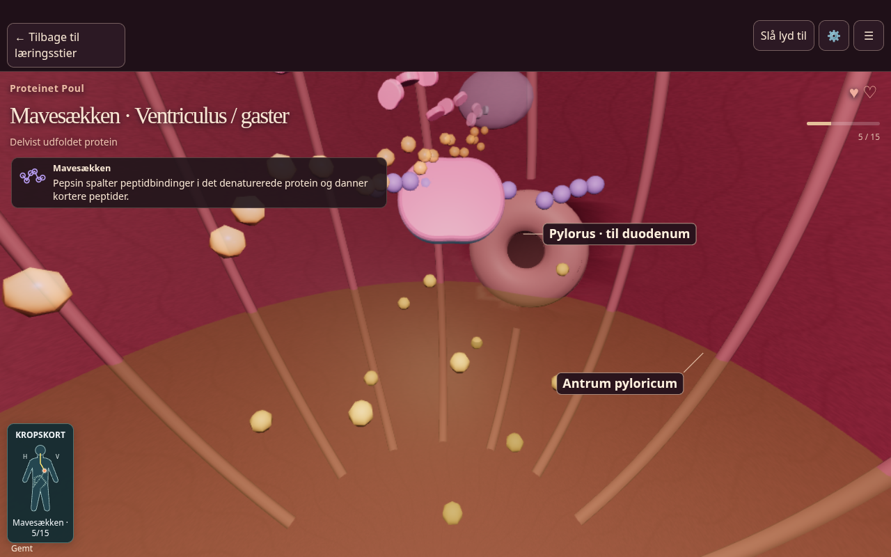
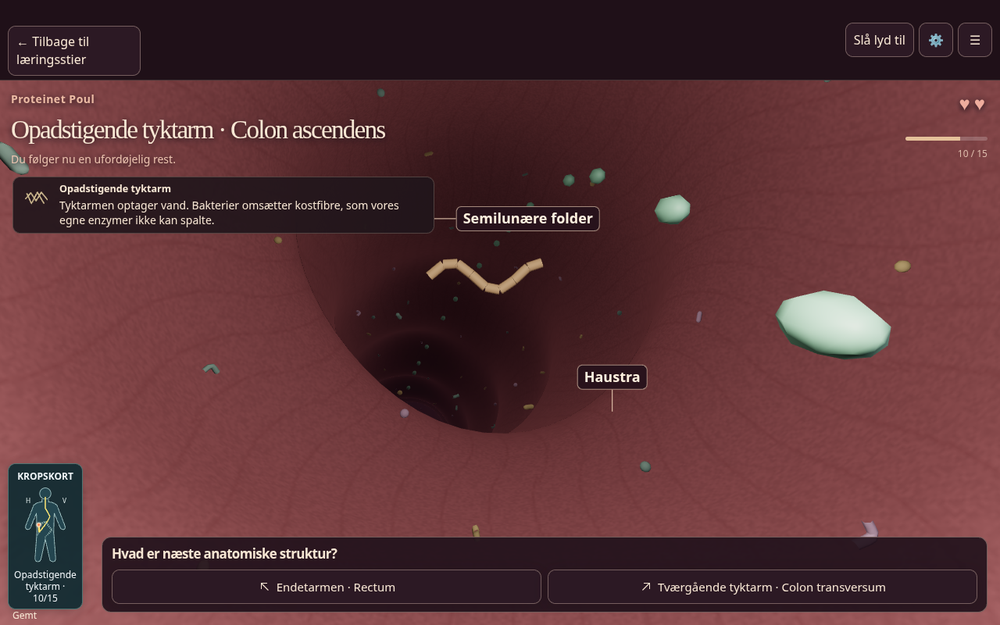

# Anatomi, enzymer, saltsyre og mikrobiota

## Udgangspunkt og afgrænsning

Arbejdet er startet fra den senest hentede `fordoejelse-sammenhaengende-verden`, commit **`1c7eb85ffaef550e35fe2d1f47d2b9e3e1686f43`**, i arbejdsbranchen `fordoejelse-anatomi-enzymer-hcl-mikrobiota`. Udgangspunktet er den sammenhængende kanal, ikke en ældre sceneopdelt version. `main` stod ved opgavens start på `f93bb976e1dc3c8c86210146e2fee9219f980d8d`. De allerede godkendte mund-, tunge- og mobilrettelser fra `7286bf4`/`f93bb976` er bevaret som konkrete ændringer oven på det ønskede udgangspunkt.

De seks forbedringsområder er udført i den bestilte rækkefølge og kontrolleret undervejs. Der er ikke indført en ny udviklingsfase eller nye spil uden for fordøjelsesrejsen.

## Ændringer

### Svælg, epiglottis og tygning

Mundhule, tungerod, larynx og den øverste fødevej bruger samme anatomiske midterplan. Epiglottis hælder frem mod tungeroden i hvile og føres bagud over luftvejen under den eksisterende koordinerede synkning. Standardblikket er rettet ned mod den faktiske larynxindgang og epiglottis. Oesophagus ligger fortsat bag luftvejen; kameraet følger fødepassagen uden at gå gennem tungen, bladet, larynx eller den øvre oesophaguslukke.

Tygningen har en fælles model for tandbuer, tandkød, underkæbebevægelse og tunge. Modsatte tandkroner mødes ved lukning; undertænder og deres tandkød bevæger sig samlet. Tungen ligger inden for tandbuerne og bevæger sig diskret. Fødebolus komprimeres mellem kindtændernes tyggeflader og bliver synligt mindre. Den eksisterende lyd bruger fortsat samme tyggefase.

Den geometriske regression undersøger de faktiske tand- og cusp-vertices ved 241 prøver gennem to hele tyggecyklusser. Ingen af disse gennemskærer tungens ellipsoide. De eksisterende tests for kanalens sammenføjninger, kamerarutens kontinuitet og synkekollisioner bevares.

### Vedvarende enzymmodel

En valgt enzymmodel flyttes fra svarmulighedernes midlertidige lag til et vedvarende lag. Samme gruppe, mesh, geometri, farve og enzymidentitet bruges gennem valg, kildespørgsmål, sekretionsanimation, funktionsspørgsmål og reaktion. Blandede svar og et forkert svar ændrer ikke denne identitet. Enzymet forbliver intakt under spaltningen og forlader først observationsfeltet efter reaktionen.

Kontrollen omfatter spytamylase, bugspytamylase, maltase, pepsin, trypsin, peptidaser og bugspytlipase. Galde indgår fortsat i sit særskilte emulsionsforløb og behandles ikke som et enzym. Ved genindlæsning rekonstrueres en model med samme faglige identitet fra det gemte deltrin; en JavaScript-objektidentitet kan naturligvis kun bevares inden for samme åbne session.

### HCl og denaturering før pepsin

Proteinrejsen har to nye spørgsmål før de bevarede pepsinopgaver: saltsyre fra parietalceller og proteiners denaturering. HCl vises som H⁺ og Cl⁻ i væsken, med sekretion fra mavevæggen. Saltsyren har hverken enzymmodel eller enzymfunktion.

Denatureringen ændrer en foldet, tredimensionel kæde til en delvist udfoldet kæde. Alle 12 enheder og 11 peptidbindinger bevares under hele denne animation. Først i den efterfølgende pepsinreaktion brydes udvalgte peptidbindinger, så der dannes kortere peptider. Proteinet forbliver udfoldet mellem spørgsmålene. Modellerne orienteres mod den normale betragtningsretning, så kæden ikke bliver set næsten fra enden.

De ønskede korte forklaringer vises i den eksisterende infoboks. Pepsinogen, parietalceller, syre og aktivering forklares i pepsinopgavens kildeforklaring. De nye HCl-spørgsmål gives kun på proteinrejsen; kulhydrat- og fedtrejserne får ingen irrelevante ekstra spørgsmål. Den afsluttende pointsammenfatning bruger betegnelsen »molekyleopgaver«, så syrespørgsmål ikke kaldes enzymopgaver.

Ældre gemninger ved pepsinopgaven fortsætter på det tilsvarende spørgsmål. Allerede optjente point og liv bevares; der uddeles ingen point for automatisk at have passeret de nye spørgsmål. Historiske slutresultater ændres ikke. Nye spil får hele det udvidede forløb. Pause og genoptagelse midt i både syresekretion og denaturering er kontrolleret.

### Opret kamera

Kameraets opadretning beregnes fra den faktiske blikretning og kroppens superior-retning, adskilt fra slimhindens geometriske transportnormal. Næsten lodrette passager bruger blød interpolation mellem nabovisninger, så et tyngdepolepunkt ikke giver et 180° rul. Kameraets øjepositioner og de anatomiske krumninger ændres ikke af denne stabilisering.

I passagen fra oesophagus gennem mavesækken til duodenum var den maksimale rulning efter midterlinjerettelsen, men før kamerarettelsen i mavesækken cirka **177,86°**. Efter rettelsen er rulningen numerisk tæt på **0°**, også i prøver med manuel rotation. Der er 1.539 registrerede prøver med standardblik og to manuelle blikretninger i [eftermålingen](anatomi-enzymer-hcl-mikrobiota/camera-roll-after.json); [førmålingen](anatomi-enzymer-hcl-mikrobiota/camera-roll-before.json) er bevaret.

Et vandret halvt drej vender hele blikretningen, også dens lodrette komponent i stejle passager. En særskilt regression kontrollerer dermed, at man fortsat kan se helt tilbage langs kanalen.

Den største korrektion af standardblikket i den testede øvre passage er cirka 14,1°. Det er en ændring af blikket ved næsten lodrette passager, ikke en ændring af kanalens form eller kamerarute. Manuel rotation bevares; blikket begrænses cirka 2,3° før en helt lodret pol for at undgå inversion.

### Læsbare anatomiske labels

Labels har faste tekststørrelser på **18 CSS-pixels på desktop** og **20 CSS-pixels på mobil**, høj kontrast og almindelig systemskrift. Teksten er uafhængig af WebGL-opløsningen og står skarpt ved reduceret renderopløsning. Linjer forbinder teksten med dens anatomiske anker. Epiglottis-ankeret følger selve bladet; vægankre følger den regionale motilitet.

Placeringen undgår andre labels, paneler, kropskort og de aktive læringsmodeller. Opdatering ved ændrede panelmål fungerer også med reduceret bevægelse. Reelt skjulte strukturer får ikke tekst gennem en solid væg. Lavere prioriterede labels kan udelades ved pladsmangel eller uden for synsfeltet. På små skærme vises højst tre samtidigt; på desktop højst fem. Dette bevarer pladsen til anatomien og gør prioriteringen stabil.

### Normal mikrobiota i colon

Caecum, colon ascendens, transversum, descendens og sigmoideum har hver 96 små, afdæmpede bakteriemodeller: stave, kugler og let buede stave. Tre instancerede meshes pr. afsnit giver tre ekstra tegnekald pr. synligt afsnit. Matrixdata lægges op én gang; diskret bevægelse beregnes med shader-uniformer og følger den eksisterende motilitet. Modellerne ligger inden for den faktiske slimhinde og repræsenterer normal mikrobiota.

De korte tekster om mikrobiota, kostfibre, kortkædede fedtsyrer og dannelse af K-vitamin og visse B-vitaminer gives ved naturlige stationsskift. Vigtige anatomiske oplysninger om blandt andet caecum og appendix bevares. Der er ingen ekstra bakteriespørgsmål, og aktiv anatomisk fejlfeedback bliver ikke overskrevet af et tidsstyret bakteriebudskab. Vitaminteksten lover ikke, at alle bakterielt dannede vitaminer optages eller dækker kroppens behov.

## Berørte filer

- Fælles anatomi og kamera: `public/digestion-anatomy.js`, `digestion-tract.js`, `digestion-swallow.js`, `digestion-route-camera.js`, `digestion-world.js` samt det nye `digestion-camera-frames.js`.
- Tygning: det nye `public/digestion-chewing.js`; de eksisterende lydfunktioner genbruges.
- Enzymer: det nye `public/digestion-enzyme-lifecycle.js`, `digestion-game.js`, `digestion-world.js` og `digestion-secretions.js`. De fælles enzymformer og farveidentiteter bevares.
- HCl og denaturering: det nye `public/digestion-acid.js`, `digestion-data.js`, `digestion-engine.js`, `digestion-learning.js`, `digestion-molecules.js` og `digestion-presentation.js`.
- Labels: `public/digestion-anatomy-labels.js`, `digestion.css` og ankerplaceringerne i verdens-/synkemodellen.
- Mikrobiota: det nye `public/digestion-microbiota.js` samt verdens- og læringsintegrationen.
- Regressioner: seks nye Node-testfiler, udvidet `test/digestion-tract.test.js`, fire nye browserkontroller samt særskilte visuelle og performancekontroller. `package.json` medtager de nye regressioner uden at fjerne de eksisterende.

## Testresultater

| Kontrol | Resultat |
| --- | --- |
| Alle Node-tests | **203/203 består**, ingen udeladte tests |
| Build | Består; Pages-aktiver i `assets/c93f26c73189` |
| `git diff --check` | Består |
| Anatomiske labels | 8 browserkontroller, desktop/mobil, ingen uhensigtsmæssige tekst-/UI-overlap; manuel rotation opret |
| HCl → denaturering → pepsin | Begge profiler består; 18 yderligere layoutkontroller; pause/genindlæsning uden dobbelte point |
| Alle syv enzymforløb | Samme UUID for gruppe, mesh og geometri fra valg til reaktion; samme farve; forkert svar ændrer ikke modellen; enzym intakt og naturlig afslutning |
| Mikrobiota | Alle fem områder på desktop og emuleret mobil, 10 kontroller; diskret bevægelse og korrekt information; fejlfeedback bevares |
| Eksisterende fase A og mund/mobil | Består ved 320, 375, 390, 768, 844, 1024 og 1280 pixels samt 568 × 320, 667 × 375 og 844 × 390; alle tre starter fortsat uden for munden |
| Sammenhængende verden | 65 kontroloptagelser, herunder alle sammenføjninger fremad/bagud og optagelse gennem den rigtige tarmvæg; ingen side-/shaderfejl |
| Gemning/progression | 9 eksisterende kontinuitetskontroller består, inklusive pauser, kameradistance, gammelt gemt forløb, galde, miceller og ufordøjelig rest |
| Visuel dokumentation | 10 nye efterbilleder, førbilleder, opgave-/label-/colonbilleder og 9 afspillelige H.264-klip; alle dokumentationslinks kontrolleret |

Browserresultaterne findes i [labels](anatomi-enzymer-hcl-mikrobiota/label-checks.json), [HCl og layout](anatomi-enzymer-hcl-mikrobiota/hcl-checks.json), [enzymkontinuitet](anatomi-enzymer-hcl-mikrobiota/enzyme-continuity.json), [mikrobiota](anatomi-enzymer-hcl-mikrobiota/microbiota-checks.json) og [gemning/progression](anatomi-enzymer-hcl-mikrobiota/continuous-state-checks.json).

Den samlede `npm run test:browser` omfatter 19 scripts og køres desuden som obligatorisk trin i [GitHub Pages-workflowet](../../.github/workflows/pages.yml), inden artefaktet udgives. Den omfatter alle tre fulde næringsstofrejser på desktop og emuleret mobil, sluttests og de øvrige læringsspils eksisterende regressioner. Deployment er afhængigt af, at dette trin, Node-tests og build lykkes; den færdige udgivelses status kan kontrolleres i [Actions](https://github.com/martinkaaekristiansen/sygepleje-laeringsstier/actions/workflows/pages.yml).

De nye timingkontroller venter på browserens faktiske visningshøjde og bruger de almindelige pauseknappers hændelser til at fryse korte sekvenser. Dermed tester en langsom software-renderer reelt gemning midt i animationen frem for efter dens slutpunkt. Spillets varighed og funktioner ændres ikke af testdriveren.

## Performance før og efter

Samme Chromium/SwiftShader, DPR 1, fast renderfaktor **0,8**, identiske kamerakoordinater, blik og opadvektor i hvert par. Hver variant måles sekventielt efter 5 sekunders opvarmning over 60 billedintervaller. FPS er beregnet fra medianbilledtiden; rå intervaller og kontrolbilleder findes i [måledata](anatomi-enzymer-hcl-mikrobiota/performance/results.json). Førversionen er den hidtil udgivne version `f93bb976`, hvis godkendte mund-/mobilrettelser også er bevaret i efterversionen.

| Visning | FPS før → efter | Billedtid, ms | Trekanter før → efter | Tegnekald |
| --- | ---: | ---: | ---: | ---: |
| desktop · mouth | 2.14 → 2.31 | 466.6 → 433.4 | 83,804 → 77,668 | 133 → 125 |
| desktop · epiglottis | 3.33 → 3.16 | 300.0 → 316.7 | 72,960 → 75,056 | 39 → 44 |
| desktop · stomach | 2.50 → 2.31 | 400.0 → 433.3 | 180,535 → 180,533 | 47 → 46 |
| desktop · ascending | 4.28 → 3.75 | 233.4 → 266.7 | 34,408 → 47,976 | 14 → 20 |
| desktop · jejunum | 1.82 → 1.76 | 550.0 → 566.6 | 313,236 → 313,236 | 28 → 28 |
| mobil · mouth | 4.28 → 4.61 | 233.4 → 216.7 | 84,108 → 75,404 | 128 → 108 |
| mobil · epiglottis | 5.45 → 5.00 | 183.4 → 199.9 | 72,768 → 73,200 | 37 → 38 |
| mobil · stomach | 4.29 → 4.00 | 233.3 → 250.0 | 180,535 → 180,533 | 47 → 46 |
| mobil · ascending | 10.00 → 8.57 | 100.0 → 116.7 | 34,408 → 47,976 | 14 → 20 |
| mobil · jejunum | 3.00 → 3.16 | 333.3 → 316.7 | 313,236 → 313,236 | 28 → 28 |

Jejunums 3.200 villi, de afrundede former og slimhindens bølgebevægelse er bevaret. De små måleudsving dér skyldes ikke en ændring af geometri eller opløsning. Colon får i dette kamerafelt to synlige bakterieafsnit: **13.568 ekstra trekanter og 6 tegnekald**. Den målte median ændres fra 4,28 til 3,75 FPS på desktop og fra 10,00 til 8,57 på emuleret mobil. Det er en reel omkostning ved det nye indhold i software-rendering, og målingen giver ikke grundlag for at love højere FPS på alle enheder.

En særskilt kontrol af label-cache viste 3,53 → 4,00 FPS på desktop og uændret 10,00 FPS på emuleret mobil med samme geometri. Derfor er den optimering bevaret: projektion og tekstplacering følger fortsat hvert billede; dyre vægskjulningskontroller genbruges i op til 800 ms ved uændret blik/anker og kontrolleres efter 200 ms ved bevægelse, straks ved layoutændring. Se [cachekontrol](anatomi-enzymer-hcl-mikrobiota/performance/label-cache-check.json).

En afprøvet reduktion af bakteriernes polygonantal gav ingen målbar FPS-forbedring og blev derfor forkastet. De afrundede modeller er bevaret. Der er ikke sænket yderligere på renderopløsningen. Kameraets og alle læringsfunktioners korrekte adfærd kontrolleres med det virkelige kamera særskilt fra de fastlåste sammenligningsmålinger.

## Visuel dokumentation

[Åbn galleriet](anatomi-enzymer-hcl-mikrobiota/galleri.html). Det samler før-/efterbilleder, korte billedforklaringer, labels på desktop og mobil, mikrobiota i alle fem afsnit samt ni MP4-klip.

PNG-billeder kan åbnes direkte i GitHub. HTML-galleriet kan åbnes lokalt sammen med sin billed- og videomappe.

### Epiglottis og svælg

Samme anatomiske observationspunkt og skærmstørrelse før og efter. Efterbilledet bruger den korrigerede midterlinje og det naturlige nedadrettede standardblik. Filmene nedenfor viser hele bevægelsen, herunder når kameraet kommer bag strubelåget.

| Før | Efter |
| --- | --- |
|  |  |
|  |  |

### Proteinets foldning og peptidbindinger

Ved denaturering ændres foldningen, mens kæden bevares. Først pepsinreaktionen spalter udvalgte bindinger.

| Foldet protein | Efter denaturering |
| --- | --- |
|  |  |

### Mikrobiota i kontekst

De nye bakterier er de små stave, kugler og buede stave mellem slimhinden og tarmindholdet. De eksisterende større indholdspartikler bevares.

- [Hele tyggecyklussen](anatomi-enzymer-hcl-mikrobiota/video/hel-tyggecyklus.mp4): samme tand-/tungegeometri som i spillet, set udefra uden den dækkende mundvæg.
- [Synkning på desktop](anatomi-enzymer-hcl-mikrobiota/video/synkning-desktop-standardblik.mp4) og [med manuel rotation](anatomi-enzymer-hcl-mikrobiota/video/synkning-desktop-manuelt-blik.mp4).
- [Synkning på mobil](anatomi-enzymer-hcl-mikrobiota/video/synkning-mobil-standardblik.mp4) og [med manuel rotation](anatomi-enzymer-hcl-mikrobiota/video/synkning-mobil-manuelt-blik.mp4).
- [HCl-sekretion](anatomi-enzymer-hcl-mikrobiota/video/hcl-sekretion.mp4).
- [Denaturering uden spaltning](anatomi-enzymer-hcl-mikrobiota/video/protein-denaturering.mp4).
- [Samme pepsin fra valg til produkter](anatomi-enzymer-hcl-mikrobiota/video/pepsin-valg-til-produkter.mp4).
- [Kamera gennem oesophagus, mavesæk og duodenum](anatomi-enzymer-hcl-mikrobiota/video/kamera-oesophagus-mave-duodenum.mp4).

## Begrænsninger og bevarede funktioner

Klip er deterministisk samplede optagelser af de faktiske modeller; deres afspilningshastighed er ikke en FPS-måling. Filmtekster er forklarende overlejringer i kontrolvisningen. Det automatiske spilforløb, knapbesvarelser og gemning testes særskilt i den almindelige brugerflade. Bakterier, molekyler og organer er stiliserede undervisningsmodeller og vises ikke i fælles biologisk målestok.

Browserkontrollen bruger Chromium og SwiftShader, herunder emuleret touchmobil. En fysisk iPhone/Safari og hardwareaccelereret mobil-WebGL er ikke til rådighed i dette miljø. Derfor kan målingerne sammenligne ændringer under ens softwarebetingelser, men kan ikke forudsige en bestemt billedhastighed på en iPhone.

Den sammenhængende kanal, bagudblik, anatomiske spørgsmål, de tre molekylerejser, galde/lipase/miceller, automatisk absorption og progression, den ufordøjelige rest, liv, point, gemning, lyd, pause, sluttest, kropskort og automatisk kvalitetsstyring er bevaret. Der er ingen nye »Se animationen igen«- eller »Fortsæt«-paneler. Ingen andre læringsspil er fjernet eller ændret funktionelt.
